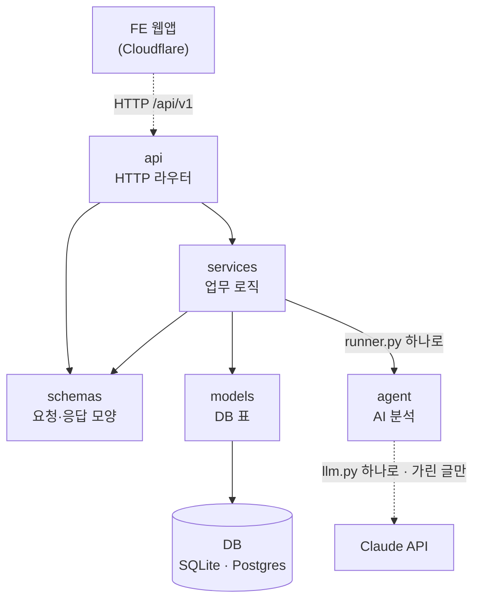
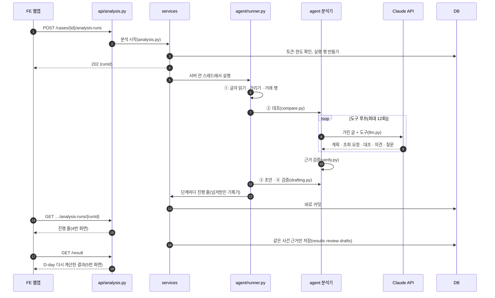

# 🏗️ 코드 구조

`app/` 아래 폴더가 각각 무엇을 맡는지, 요청 하나가 어떤 파일을 거치는지 정리했습니다. 규칙의 근거는 `CLAUDE.md` "코드 구조"와 "지켜야 할 원칙"입니다.

---

## 🧭 한눈에 보기

```text
proofy-server/
├─ app/
│  ├─ main.py config.py db.py errors.py   앱 생성, 설정, DB 연결, 공통 오류 응답
│  ├─ api/        🚪 HTTP 라우터(업무 로직 없음)
│  ├─ schemas/    📐 요청·응답 모양(API 계약과 1:1)
│  ├─ models/     🗄️ DB 표(ERD와 1:1)
│  ├─ services/   ⚙️ 업무 로직: 코드가 만드는 모든 것
│  ├─ agent/      🤖 AI 분석: DB를 모르는 분석 엔진
│  └─ samples/    🧪 체험 계정 합성 서류
├─ tests/         계약 테스트와 기능 테스트(작업 번호별 파일)
├─ scripts/       합성 서류 만들기, Claude 스키마 확인
├─ docs/          문서
└─ Dockerfile     배포 이미지(파이썬 + Tesseract 한국어 + poppler)
```

### 🔗 모듈 의존 방향

화살표는 "import한다(부른다)"는 뜻이다. 실제 코드의 import를 세어 그렸다. 점선은 서버 밖으로 나가는 호출이다.



- **한쪽으로만 흐른다.** `api → services → models`. 라우터는 DB를 직접 만지지 않는다
- **`agent`는 `services`·`models`·`db`를 import하지 않는다.** 받은 글을 분석해 결과 모양만 채우고, 저장과 최종 확인은 `services`가 한다
- **AI 분석의 입구는 `agent/runner.py` 하나, 외부 AI 호출은 `agent/llm.py` 하나**뿐이다

---

## 📂 폴더별 역할

### 🚪 `api/` — 문지기 (HTTP 라우터)

- **하는 일:** URL을 받아 `services`의 함수 하나를 부르고 결과를 돌려준다. 업무 로직은 넣지 않는다
- **크기:** 파일 9개, 각 11~31줄로 얇다
- **파일**
  - `cases.py`: 사건 만들기·조회·수정·삭제(계약 4.3~4.6)
  - `samples.py`: 체험 계정 사건(4.3.1)
  - `evidence.py`: 증빙 올리기·목록·지우기(4.7)
  - `checklist.py`: 체크리스트(4.8)
  - `analysis.py`: 분석 시작·진행(4.9·4.10)
  - `result.py`: 분석 결과(4.11)
  - `draft.py`: 소명서 초안(4.12)
  - `meta.py`: 사건 없이 부르는 안내(4.2)
  - `health.py`: 상태 확인과 하루 사용량(4.1)
- **왜 얇게:** 계약이 바뀌어도 URL 연결만 고치면 되고, 업무 규칙 테스트는 `services`만 보면 된다

### 📐 `schemas/` — 요청·응답 모양 (계약의 코드판)

- **하는 일:** FE와 주고받는 JSON 모양을 Pydantic으로 정의한다. `docs/contract.md`와 1:1
- **camelCase:** 모두 `CamelModel`(`common.py`)을 상속한다. 파이썬에서는 `case_id`, JSON으로 나갈 때는 `caseId`
- **주요 파일:** `result.py`(결과 화면, 가장 큼), `draft.py`(초안), `case.py`(사건), `analysis.py`(분석 실행)
- **지키는 것:** 판정 필드(해제 가능성, 수용 여부 등)를 두지 않는다(원칙 1). 계약 테스트 T16-a·T10-e가 확인한다

### 🗄️ `models/` — DB 표

- **하는 일:** SQLAlchemy 테이블 정의. `docs/erd.md`와 1:1이고, 새 모델은 `models/__init__.py`에서 import한다
- **파일**
  - `case.py`: 사건, 사용자가 말한 입금
  - `evidence.py`: 올린 서류와 파일 내용(파일도 DB에 저장)
  - `transaction.py`: 거래내역서에서 뽑은 거래 행
  - `analysis.py`: 분석 실행(단계·step 기록 포함)
  - `finding.py`: 주장별 대조 결과와 근거
  - `checklist.py`: 준비 서류 체크
  - `draft.py`: 소명서 초안(사건당 현재본 1행)
  - `review.py`: AI 조건부 의견과 질문·답
  - `usage.py`: 사용량 로그(사건과 분리해 사건을 지워도 남음)
- **지키는 것:** 계산하지 않고 저장만 한다. D-day, 충족 여부, 확인 필요 수처럼 계산되는 값은 저장하지 않고 읽을 때 계산한다

### ⚙️ `services/` — 업무 로직 (코드가 만드는 모든 것)

원칙 2 "숫자·날짜·기한은 코드가 만든다"를 맡는다. DB를 읽고 쓰고, AI 분석을 부르고, AI 결과를 검증해 저장한다.

- **사건·서류**
  - `cases.py`: 사건 만들기·조회·수정·삭제, 응답마다 D-day 다시 계산
  - `evidence.py`: 증빙 저장(원본은 DB)
  - `samples.py`: 체험 계정 사건(통지일·공고일만 오늘 기준 상대 날짜)
  - `auth.py`: 사건 토큰(서버 로그인 없이 사건 보호)
- **계산**
  - `deadline.py`: 이의제기 기한과 D-day(계약 5절)
  - `requirements.py`·`checklist.py`: 유형별 서류 목록과 충족 여부
  - `drafts.py`: 초안 저장·수정, "확인 필요" 규칙
- **분석 흐름**
  - `analysis.py`: 분석 시작, 서버 안 스레드 실행, 한도 검사, 샘플 대체 결과(가장 큰 서비스)
  - `results.py`: AI 출력을 같은 사건 소속인지 확인해 저장, 결과 응답 만들기
  - `review.py`: AI 의견·질문 저장과 `agentReview`
  - `questions.py`: 답변 받기, 지난 분석 성찰 거리 모으기
  - `runs.py`: 실행 조회 도우미
- **안전·운영**
  - `safety.py`: 상담 안내 후보 표현 찾기(판단은 AI)
  - `usage.py`: 하루·시간당 한도
  - `cleanup.py`: 24시간 자동 삭제
  - `legal.py`: 법령 안내 문구(코드 상수)
  - `clock.py`: 서버 시각(UTC)

### 🤖 `agent/` — AI 분석 (DB를 모르는 분석 엔진)

- **입구:** `runner.py`. 분석기를 고르고 ①②③ 단계를 순서대로 부른다. 단계·step은 넘겨받은 기록기로만 남긴다
- **분석기 두 개** (같은 결과 모양 `output.py`를 채운다)
  - `scripted.py`: 가짜 분석기(`AGENT_LLM=scripted`). Claude 없이 정해 둔 결과. 테스트, FE 연동, 샘플 대체 결과용
  - `compare.py`: 실제 Claude 대조 에이전트. 조사 계획, 도구 루프, 의견·질문(가장 큰 파일)
- **① 읽기 (코드, AI 없음)**
  - `extract/`: 텍스트 PDF 글자(`pdf_text.py`), OCR(`ocr.py`), 사진 전처리(`preprocess.py`)
  - `masking.py`: 이름·계좌·전화·사업자번호 가리기. 결과는 `MaskedText` 타입
  - `transactions.py`: 거래내역서 줄 → 거래 행(규칙)
- **②③④ AI와 검증**
  - `compare.py` → `verify.py`: 대조 후 근거 검증(조회한 거래만, 인용 원문 대조)
  - `drafting.py`: 초안 작성, 후검증, 1회 고쳐 쓰기
  - `consult.py`: 상담 안내 정하기
- **도구·유틸**
  - `law.py` + `law_data/`: 법령 검색·조항 읽기(법·시행령·별지 제4호 원문)
  - `numbers.py`: 문장 속 금액·날짜 읽기
  - `steps.py`: 단계·step·오류 정의
- **외부 AI 호출:** `llm.py` 한 곳. `MaskedText`(가린 글)가 아니면 받지 않는다(원칙 4)

### 🧪 `samples/` — 체험 계정 합성 서류

- `goods/`: test01 물품 거래(거래내역서 PDF, 대화·사업자등록증명 PNG)
- `unexpected/`: test02 통장 묶기(거래내역서 PDF, 협박 문자 PNG)
- 코드가 아니라 데이터다. `scripts/make_samples.py`로 만들었고 인물·번호·기관은 모두 지어낸 값이다

### 📄 `app/` 바로 아래 파일

- `main.py`: 앱 생성, 라우터를 `/api/v1`에 연결, 시작할 때 테이블 생성과 자동 삭제 스레드 시작
- `config.py`: 환경변수(`.env`). 키는 여기로만 받는다(원칙 5)
- `db.py`: DB 연결과 세션
- `errors.py`: 공통 오류 응답 `{ "error": { code, message, details } }`(계약 1.1)

### 🧷 `tests/`·`scripts/`

- `tests/test_tNN_*.py`: 작업 번호별 테스트. 계약 테스트 목록은 `docs/tasks/README.md`
- `tests/flow.py`·`conftest.py`: 공용 흐름과 테스트 앱. `fake_claude.py`는 실제 API를 부르지 않는 가짜 Claude
- `scripts/make_samples.py`: 체험 계정 합성 서류 만들기
- `scripts/check_claude_schema.py`: 출력 스키마가 실제 Claude API에서 거절되지 않는지 확인(스키마를 바꿀 때마다)

---

## 🎬 장면으로 보기: test01에서 "분석 시작"을 누르면



1. **`api/analysis.py`** 가 `POST /cases/{id}/analysis-runs`를 받아 `services/analysis.py`에 넘긴다
2. **`services/analysis.py`**
   - 사건 토큰(`auth.py`), 한도(`usage.py`)를 확인하고 상담 표현 후보(`safety.py`)를 찾는다
   - 실행 행(`models/analysis.py`)을 만들고 바로 202를 돌려준다. 분석은 서버 안 스레드에서 이어진다
3. 스레드가 **`agent/runner.py`** 를 부른다
   - ① `extract/`가 글자를 읽고 `masking.py`가 이름을 `김*수`처럼 가린다. `transactions.py`가 거래 행을 뽑는다
   - ② `compare.py`가 `llm.py`를 거쳐 Claude와 도구 루프를 돈다(조사 계획 → 거래·서류·법령 조회 → 대조·의견·질문). `verify.py`가 근거를 거른다
   - ③ `drafting.py`가 초안을 쓰고 검사해, 고칠 수 있는 것만 1회 고쳐 쓰게 한다
4. 단계마다 진행 줄이 DB에 바로 남는다. FE는 `GET …/analysis-runs/{runId}`로 받아 4번 화면에 한 줄씩 보여 준다
5. 끝나면 **`services/results.py`·`review.py`·`drafts.py`** 가 한 번 더 확인한다. 다른 사건 근거는 빼고, "확인 필요"는 코드가 정해 `models/`에 저장한다
6. FE가 `GET /result`를 부르면 `services/results.py`가 D-day를 다시 계산해 `schemas/result.py` 모양으로 돌려준다

---

## 💬 한 줄 요약

**AI(`agent`)는 DB를 모르고 가린 글만 받아 분석한다. 저장과 숫자 계산, 최종 확인은 코드(`services`)가 쥔다.** "어떤 결정을 AI에, 어떤 결정을 코드에 맡겼나"는 [`agent-design-v2.md`](agent-design-v2.md) 2절에 더 자세히 있다.
