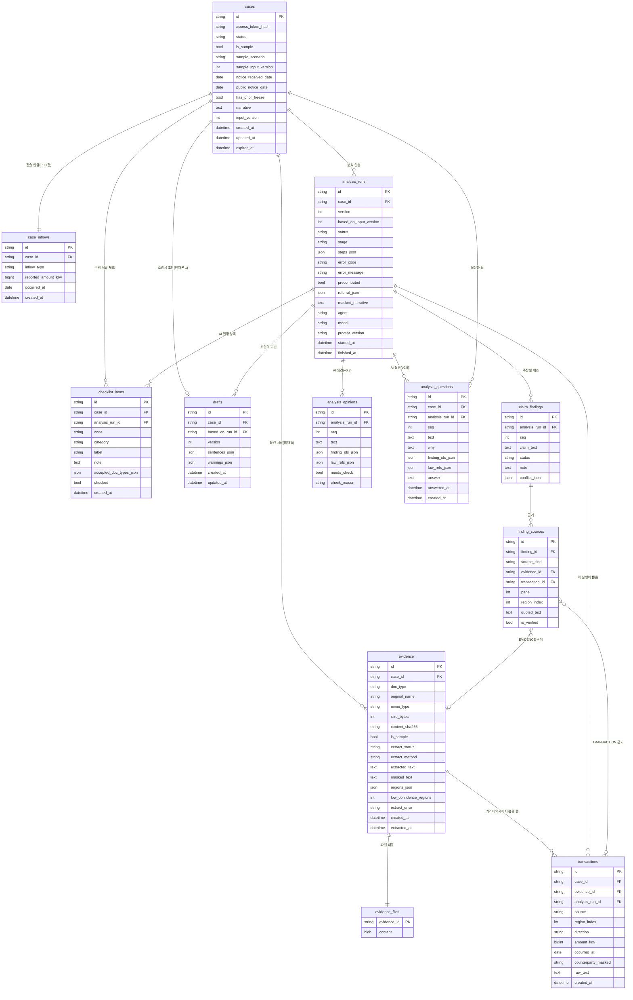
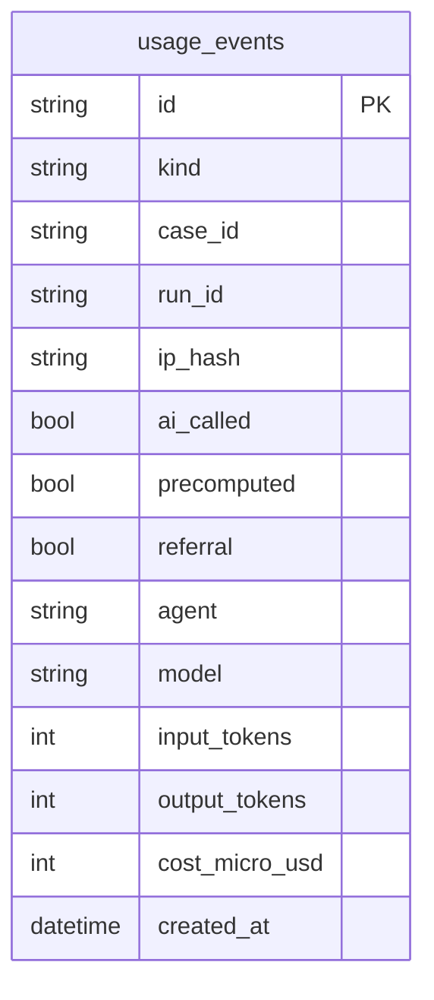
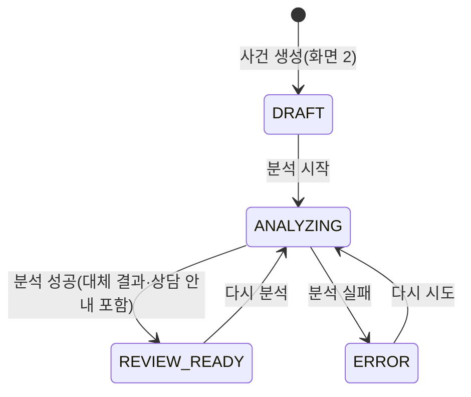

# Proofy ERD v1.4 (P0)

- 작성 2026-11-21 · **데이터 모델 정본.** 구현(`app/models/`)과 다르면 이 문서를 먼저 고치고 구현을 맞춘다
- 근거: 초안 `etc/proofy_erd_v0.1.md`(레포 밖), 검토 결정 `docs/erd-review.md`, API 계약 `docs/contract.md` v0.6, AI 흐름 `docs/agent-design.md`
- v1.1(2026-11-21): FE 수정 요청 반영. `usage_events` 추가(한도·비용을 사건과 분리), 증빙 파일을 DB에 저장(`evidence_files`), 인용 검증 기준을 마스킹한 글로 명시, `input_version`은 값이 실제로 바뀔 때만, 상담 안내 실행은 이전 초안 삭제
- v1.2(2026-11-22, T08): `finding_sources.seq`(근거 화면 순서) 추가, 서류를 지우면 그 서류에서 나온 거래 행·근거도 함께 지움(ON DELETE CASCADE, 결과는 `isStale`), AI 권장 항목 상한 3개와 충족 계산 규칙
- v1.3(2026-11-22, T09): `drafts.edited_at`(사용자가 저장한 적 있음 → 다시 분석 시 `DRAFT_HAS_EDITS`)
- v1.4(2026-11-22, 계약 v0.8): `analysis_opinions`(AI 조건부 의견), `analysis_questions`(AI 질문과 사용자 답). v0.1의 P1 질문 테이블을 P0로 올림. **새 표만 추가라 배포 DB 초기화가 필요 없다**
- DB: 로컬 SQLite, 배포 Postgres. UUID는 문자열(36자), JSON은 SQLAlchemy `JSON` 타입(둘 다 동작), 시각은 UTC로 저장
- 테이블 생성: 서버 시작 시 생성. Alembic은 미룸(11/22, T22). 표가 바뀌면 배포 DB 표를 지우고 다시 만든다(합성 데이터)

> 📖 **이 문서 읽는 법**
> - **한눈에 보기:** 2절 관계도(사건 하나에 서류·분석 실행·초안·질문이 매달린 구조)
> - **무엇을 저장하지 않나(개인정보·판정):** 1절 원칙
> - **컬럼 이름·타입·제약:** 3절 테이블별 표
> - **버전·상태가 언제 바뀌나:** 4절 · **이번에 만들지 않은 것:** 6절
> - **결정의 이유:** `docs/erd-review.md`
> - 컬럼 표는 찾아보는 용도라 표로 둔다

## 1. 원칙

| 원칙 | 데이터에서 어떻게 지키나 |
|---|---|
| 진술과 증거를 섞지 않는다 | 사용자가 말한 입금액은 `case_inflows.reported_amount_krw`, 서류에서 뽑은 거래는 `transactions.amount_krw`. 두 값을 합치거나 덮어쓰지 않는다 |
| AI는 조건부 의견까지만 낸다 | 해제·수용 가능성, 판정 갈래, 제출·심사 상태 컬럼이 없다. `MATCH`는 "일치하는 자료가 있다"는 뜻일 뿐이다. AI 의견은 문장(`analysis_opinions.text`)으로만 저장하고 초안(`drafts`)과 섞지 않는다 |
| 숫자·날짜는 코드가 만든다 | D-day, 체크리스트 충족 여부, `unconfirmedCount`, `isStale`은 저장하지 않고 읽을 때 계산한다 |
| 근거는 같은 사건 안에서만 | `finding_sources`가 가리키는 증빙·거래는 같은 사건 소속이어야 한다. FK만으로는 못 막으므로 서버 검증기가 확인한다 |
| 개인정보 최소화 | 신분증, 신청인 인적사항(별지 제4호 이름·주소·계좌)은 저장하지 않는다. AI에는 마스킹한 글(`masked_text`, 마스킹한 사연)만 보낸다. 사건은 24시간 뒤 삭제. 사용량 로그(`usage_events`)에는 개인정보를 두지 않는다 |

## 2. 관계도

모든 하위 테이블은 `cases` 삭제 시 함께 삭제된다(ON DELETE CASCADE). 증빙 파일도 `evidence_files`에 있으므로 함께 지워진다.

사건과 따로 있는 테이블: `usage_events`(3.10). 사건과 FK로 묶지 않아 사건을 지우거나 24시간 정리가 돌아도 남는다. 한도와 비용은 여기서 센다.

## 3. 테이블 명세

표기: **필수** = NOT NULL. 만드는 작업은 `docs/tasks/`의 작업 번호.

### 3.1 `cases` — 사건 (T03)

| 컬럼 | 타입 | 제약 | 의미 |
|---|---|---|---|
| `id` | UUID | PK | 사건 ID (`caseId`) |
| `access_token_hash` | CHAR(64) | 필수 | `caseToken`의 SHA-256. 토큰 원문은 저장하지 않는다 |
| `status` | VARCHAR(16) | 필수, 기본 `DRAFT` | `DRAFT` · `ANALYZING` · `REVIEW_READY` · `ERROR` |
| `is_sample` | BOOLEAN | 필수, 기본 false | 체험 계정으로 만든 사건 |
| `sample_scenario` | VARCHAR(16) | NULL | `GOODS` · `UNEXPECTED` · `SALARY` |
| `sample_input_version` | INTEGER | NULL | 샘플 생성 직후의 `input_version`. 지금 값과 같으면 "샘플 그대로" → AI 실패 시 미리 만든 결과 사용(계약 4.10) |
| `notice_received_date` | DATE | 필수 | 지급정지 통지를 **받은 날**. 미래 불가 |
| `public_notice_date` | DATE | NULL | 채권소멸절차 개시 **공고일**. 모르면 NULL. 미래 불가 |
| `has_prior_freeze` | BOOLEAN | NULL | 과거 지급정지 이력. 모름(NULL)과 없음(false) 구분 |
| `narrative` | TEXT | NULL, 2000자 이하 | 사연(진술). 화면 3에서 채운다 |
| `input_version` | INTEGER | 필수, ≥1, 기본 1 | 사연·입금 정보·날짜가 **실제로 다른 값으로** 바뀌거나 증빙을 추가·삭제할 때 +1. 같은 값을 다시 저장하면 그대로(4절) |
| `created_at` · `updated_at` | TIMESTAMP(UTC) | 필수 | |
| `expires_at` | TIMESTAMP(UTC) | 필수 | `created_at` + 24시간. 지나면 404, 주기 정리로 삭제(T11) |

저장하지 않는 것: D-day(`deadline`, 읽을 때 계산), `evidenceCount`·`latestRun`·`hasResult`(조회로 계산)

### 3.2 `case_inflows` — 사용자가 말한 입금 (T03)

| 컬럼 | 타입 | 제약 | 의미 |
|---|---|---|---|
| `id` | UUID | PK | |
| `case_id` | UUID | FK, **UNIQUE**(P0 사건당 1건) | |
| `inflow_type` | VARCHAR(16) | 필수 | `SALARY` · `GOODS` · `UNEXPECTED` · `OTHER`. 사용자 설명 분류이지 법적 사유 판정이 아니다 |
| `reported_amount_krw` | BIGINT | 필수, 1~10,000,000,000 | 사용자 **진술** 금액. API 필드는 `inflow.amountKrw` |
| `occurred_at` | DATE | NULL | 사용자가 말한 입금일. 미래 불가 |
| `created_at` | TIMESTAMP(UTC) | 필수 | |

### 3.3 `evidence` — 올린 서류와 읽은 글자 (T05, 글자 추출은 T13·T14)

| 컬럼 | 타입 | 제약 | 의미 |
|---|---|---|---|
| `id` | UUID | PK | `evidenceId` |
| `case_id` | UUID | FK | 사건당 최대 8개(서버 검증) |
| `doc_type` | VARCHAR(32) | 필수 | 계약 `DocType`. 신분증 값은 없다 |
| `original_name` | VARCHAR(255) | 필수 | |
| `mime_type` | VARCHAR(64) | 필수 | 파일 내용으로 판별한 `image/jpeg`·`image/png`·`application/pdf` |
| `size_bytes` | INTEGER | 필수, ≤10MB | |
| `content_sha256` | CHAR(64) | 필수 | 무결성 확인. 파일 내용은 `evidence_files`(3.3.1) |
| `is_sample` | BOOLEAN | 필수, 기본 false | 합성 샘플 서류 |
| `extract_status` | VARCHAR(16) | 필수, 기본 `UPLOADED` | `UPLOADED` · `PROCESSING` · `READY` · `FAILED` |
| `extract_method` | VARCHAR(16) | NULL | `PDF_TEXT`(OCR 생략) · `OCR` |
| `extracted_text` | TEXT | NULL | 추출 원문. **서버 안에서만** 쓰고 외부 AI에 보내지 않는다 |
| `masked_text` | TEXT | NULL | 주민번호·계좌·전화·이름을 가린 글. AI에는 이것만 보낸다(T14) |
| `regions_json` | JSON | NULL | 줄 단위 영역 `[{index, page, text, maskedText, bbox, confidence}]`. **인용 검증은 `maskedText`와 대조한다**(AI가 본 글이 마스킹본이므로). `text`는 서버 안에서 거래 행의 금액·날짜 확인(3.4)에만 쓴다 |
| `low_confidence_regions` | INTEGER | NULL | 신뢰도 낮은 영역 수(계약 `lowConfidenceRegions`) |
| `extract_error` | VARCHAR(200) | NULL | 못 읽은 이유("직접 확인" 안내용) |
| `created_at` · `extracted_at` | TIMESTAMP(UTC) | 뒤는 NULL | |

### 3.3.1 `evidence_files` — 증빙 파일 내용 (T05)

호스팅 디스크는 재시작·재배포 때 지워질 수 있다. 파일만 사라지고 사건이 남아 분석이 깨지지 않게 **파일 내용을 DB에 둔다.** 사건당 최대 80MB(10MB × 8)이고 24시간 뒤 사건과 함께 지워진다.

| 컬럼 | 타입 | 제약 | 의미 |
|---|---|---|---|
| `evidence_id` | UUID | PK, FK(`evidence`, ON DELETE CASCADE) | |
| `content` | BLOB(Postgres `BYTEA`) | 필수 | 업로드한 파일 원본. 응답으로 내보내지 않고 외부 AI에도 보내지 않는다 |

`evidence`와 나눈 이유: 목록·결과를 조회할 때 파일 내용을 읽지 않게 하려고.

### 3.4 `transactions` — 거래내역서에서 뽑은 거래 행 (T08 샘플용, T15 실제 추출)

초안의 `demo_transactions`(은행 원장 흉내)를 대신한다. 신청인은 은행 원장을 볼 수 없으므로, **사용자가 낸 거래내역서**에서 뽑은 행을 대조 대상으로 쓴다.

| 컬럼 | 타입 | 제약 | 의미 |
|---|---|---|---|
| `id` | UUID | PK | `transactionId` |
| `case_id` | UUID | FK | 같은 사건 검증을 쉽게 하려고 둔다 |
| `evidence_id` | UUID | FK(ON DELETE CASCADE) | 어느 거래내역서에서 뽑았나(`docType=TRANSACTION_RECORD`). 서류를 지우면 행도 지운다 |
| `analysis_run_id` | UUID | FK | 어느 분석 실행이 뽑았나. 재분석하면 새로 뽑는다 |
| `source` | VARCHAR(16) | 필수 | `STATEMENT`(거래내역서). 확장 시 `OPEN_BANKING` |
| `region_index` | INTEGER | 필수 | `evidence.regions_json`의 위치 |
| `direction` | VARCHAR(3) | 필수 | `IN` · `OUT` |
| `amount_krw` | BIGINT | 필수, >0 | 서류에 적힌 금액. 원문 영역에 이 금액 문자열이 실제로 있을 때만 저장 |
| `occurred_at` | DATE | 필수 | 서류에 적힌 거래일. 같은 조건 |
| `counterparty_masked` | VARCHAR(100) | NULL | 가린 상대방 이름(`김*수`) |
| `raw_text` | TEXT | 필수 | 원문 행. 서버 안에서만 쓴다 |
| `created_at` | TIMESTAMP(UTC) | 필수 | |

### 3.5 `analysis_runs` — 분석 실행 (T07, 항목별로 T08·T10·T11·T16)

| 컬럼 | 타입 | 제약 | 의미 |
|---|---|---|---|
| `id` | UUID | PK | `runId` |
| `case_id` | UUID | FK | 사건당 동시 실행 1개(서버 검증) |
| `version` | INTEGER | 필수, UNIQUE(case_id, version) | 사건별 분석 횟수 |
| `based_on_input_version` | INTEGER | 필수 | 시작할 때의 `cases.input_version`. 다르면 결과 `isStale: true` |
| `status` | VARCHAR(16) | 필수 | `RUNNING` · `SUCCEEDED` · `FAILED` (기술 상태) |
| `stage` | VARCHAR(16) | 필수 | `EXTRACTING` · `COMPARING` · `DRAFTING` · `FINISHED` (화면 단계) |
| `steps_json` | JSON | 필수, 기본 `[]` | 4번 화면 `steps` + 도구 호출 기록(도구가 **실제로 돌려준 거래 ID** 포함 → 후검증 기준) |
| `error_code` · `error_message` | VARCHAR | NULL | `AGENT_FAILED` · `AGENT_TIMEOUT` · `AGENT_REFUSED` |
| `precomputed` | BOOLEAN | 필수, 기본 false | 샘플 사건에서 AI 대신 미리 만든 결과를 썼나(T11) |
| `referral_json` | JSON | NULL | 상담 안내 `{code, matchedPhrases}`. 있으면 초안을 만들지 않고, 사건에 남아 있던 이전 초안을 지운다(T10) |
| `masked_narrative` | TEXT | NULL | 이 실행이 AI에 보낸 마스킹한 사연. 사연 인용(`NARRATIVE`)의 검증 기준(T14·T17). 상담 안내로 끝난 실행은 NULL |
| `agent` | VARCHAR(16) | 필수 | `scripted` · `claude` |
| `model` · `prompt_version` | VARCHAR | NULL | 예: `claude-opus-5-5`, 프롬프트 버전 |
| `started_at` · `finished_at` | TIMESTAMP(UTC) | 뒤는 NULL | 150초 넘으면 서버가 실패 처리 |

### 3.6 `claim_findings` — 주장별 대조 결과 (T08)

| 컬럼 | 타입 | 제약 | 의미 |
|---|---|---|---|
| `id` | UUID | PK | `findingId` |
| `analysis_run_id` | UUID | FK | |
| `seq` | INTEGER | 필수 | 화면 순서 |
| `claim_text` | TEXT | 필수 | 사연에서 나온 주장 |
| `status` | VARCHAR(16) | 필수 | `MATCH` · `CONFLICT` · `STATEMENT_ONLY` · `UNKNOWN`. 판정이 아니다 |
| `note` | TEXT | NULL | 보조 설명 |
| `conflict_json` | JSON | NULL | `CONFLICT`일 때 `{field: AMOUNT·DATE·COUNTERPARTY·OTHER, statement, found}` |

### 3.7 `finding_sources` — 주장의 근거 (T08, 검증은 T17)

| 컬럼 | 타입 | 제약 | 의미 |
|---|---|---|---|
| `id` | UUID | PK | |
| `finding_id` | UUID | FK | 주장 하나에 근거 여러 개 |
| `seq` | INTEGER | 필수 | 주장 안에서 근거 화면 순서 |
| `source_kind` | VARCHAR(16) | 필수 | `EVIDENCE` · `TRANSACTION` · `NARRATIVE` |
| `evidence_id` | UUID | FK NULL(ON DELETE CASCADE) | `EVIDENCE`일 때만 |
| `transaction_id` | UUID | FK NULL(ON DELETE CASCADE) | `TRANSACTION`일 때만 |
| `page` · `region_index` | INTEGER | NULL | `EVIDENCE`의 위치 |
| `quoted_text` | TEXT | NULL | 인용 문구(`EVIDENCE`·`NARRATIVE`) |
| `is_verified` | BOOLEAN | 필수 | 서버 검증 통과 여부. false면 화면에 흐리게 표시 |

**CHECK:** `EVIDENCE` → `evidence_id`만 값 있음 / `TRANSACTION` → `transaction_id`만 값 있음 / `NARRATIVE` → 둘 다 NULL

**서버 검증기(T17)가 확인하는 것** (FK로는 못 막는 것)
1. 가리키는 증빙·거래가 **같은 사건** 소속인가
2. `transaction_id`가 **이번 실행의 도구가 실제로 돌려준 ID**인가(`analysis_runs.steps_json`)
3. `quoted_text`가 **마스킹한 글**에 실제로 있는가(공백 무시 부분 문자열). `EVIDENCE`는 `evidence.regions_json[region_index].maskedText`, `NARRATIVE`는 `analysis_runs.masked_narrative`와 대조한다. 원문(`text`)과 대조하면 AI가 본 가린 글(`김*수`)이 모두 불일치가 된다
4. 실패한 근거는 지우지 않고 `is_verified=false`, 연결된 초안 문장은 "확인 필요"

### 3.8 `checklist_items` — 준비 서류 체크 (T04, AI 권장은 T08)

유형별 공식·안내 서류 **목록은 코드 상수**(`docs/contract.md` 4.2, 출처 포함)이고, 이 테이블은 사건별 행(체크 표시 보관용)과 AI 권장 항목만 저장한다. 충족 여부(`status`)는 올린 서류의 `doc_type`으로 읽을 때 계산한다.

| 컬럼 | 타입 | 제약 | 의미 |
|---|---|---|---|
| `id` | UUID | PK | `itemId` |
| `case_id` | UUID | FK | |
| `analysis_run_id` | UUID | FK NULL | AI 권장 항목만 값 있음 |
| `code` | VARCHAR(40) | NULL | 상수 항목 코드(`TRADE_DOCUMENT` 등). AI 권장은 NULL |
| `category` | VARCHAR(20) | 필수 | `OFFICIAL_REQUIRED` · `TYPE_GUIDE` · `ANALYSIS_INPUT` · `OPTIONAL` · `AI_RECOMMENDED` |
| `label` · `note` | TEXT | NULL | AI 권장 항목의 문구. 상수 항목은 코드 상수에서 읽는다 |
| `accepted_doc_types_json` | JSON | NULL | AI 권장 항목이 충족되는 `docType` 목록 |
| `checked` | BOOLEAN | 필수, 기본 false | 사용자가 "따로 준비함"을 누른 표시. 충족 여부와 별개 |
| `created_at` | TIMESTAMP(UTC) | 필수 | |

**CHECK:** 상수 항목(`code` 값 있음, `analysis_run_id` NULL) 또는 AI 권장 항목(`code` NULL, `analysis_run_id` 값 있음, `category = AI_RECOMMENDED`). AI 권장 항목을 공식 의무로 바꾸지 않는다.

AI 권장 항목은 한 실행당 최대 3개다. 충족 여부는 `accepted_doc_types_json` 중 **그 사건의 상수 항목이 받지 않는 `docType`** 으로만 계산한다(계약 v0.6.5 4.8). `analysis_run_id`는 FK(ON DELETE CASCADE).

입금 유형이 바뀌면(PATCH) 상수 항목 행을 새 유형 목록으로 다시 만들고, 같은 `code`의 `checked`는 이어받는다.

### 3.9 `drafts` — 소명서 초안 (T09, 실제 작성은 T17)

| 컬럼 | 타입 | 제약 | 의미 |
|---|---|---|---|
| `id` | UUID | PK | |
| `case_id` | UUID | FK, **UNIQUE**(사건당 현재본 1개) | |
| `based_on_run_id` | UUID | FK | 초안의 기반 분석 |
| `version` | INTEGER | 필수, ≥1 | 저장할 때마다 +1. `expectedVersion`이 다르면 409 |
| `sentences_json` | JSON | 필수 | `[{sentenceId, section, text, origin: AI·USER, findingIds[], needsCheck, needsCheckReason, confirmed, edited}]`. `section`은 계약 `DraftSection`(사용자 문장은 `null`) |
| `warnings_json` | JSON | 필수, 기본 `[]` | `CONFLICT_NOT_IN_DRAFT` 등 |
| `created_at` · `updated_at` | TIMESTAMP(UTC) | 필수 | |
| `edited_at` | TIMESTAMP(UTC) | NULL 허용 | 사용자가 `PUT`으로 마지막에 저장한 시각. 분석으로 새로 만들면 NULL. 값이 있으면 다시 분석할 때 `409 DRAFT_HAS_EDITS`(T09, v1.3) |

저장하지 않는 것: `unconfirmedCount`, `fullText`(읽을 때 계산). 상담 안내(`referral_json`)가 있는 실행은 초안을 만들지 않고, 그 실행이 성공하면 이 사건의 `drafts` 행을 지운다(계약 4.11: 이때 `GET /draft`는 404).

### 3.10 `usage_events` — 사용량 로그 (T07 기록, T11 한도, 비용은 T16·T19)

한도와 비용을 사건과 분리해서 센다. **사건과 FK로 묶지 않는다**(사건을 지워도 남는다). 개인정보가 없다.

| 컬럼 | 타입 | 제약 | 의미 |
|---|---|---|---|
| `id` | UUID | PK | |
| `kind` | VARCHAR(16) | 필수 | `CASE_CREATE`(사건·샘플 사건 생성) · `ANALYSIS_RUN`(분석 시작) |
| `case_id` | UUID | 필수, FK 아님 | 사건당 시간당 분석 5회 계산용. 사건이 지워져도 값만 남는다 |
| `run_id` | UUID | NULL, FK 아님 | `ANALYSIS_RUN`일 때 |
| `ip_hash` | CHAR(64) | NULL | `HMAC-SHA256(IP_HASH_SECRET, IP)`. IP 원문은 저장하지 않는다. 24시간 정리 때 NULL로 비운다 |
| `ai_called` | BOOLEAN | 필수, 기본 false | 외부 AI를 불렀나. **하루 한도는 이 값이 true인 행만 센다**(상담 안내, 한도 초과로 쓴 미리 만든 결과는 false) |
| `precomputed` · `referral` | BOOLEAN | 필수, 기본 false | 미리 만든 결과로 끝났나, 상담 안내로 끝났나 |
| `agent` | VARCHAR(16) | NULL | `scripted` · `claude` |
| `model` | VARCHAR | NULL | 예: `claude-opus-5-5` |
| `input_tokens` · `output_tokens` · `cost_micro_usd` | INTEGER | NULL | 실행이 끝날 때 채운다. 비용 실측(T19, 소개서) |
| `created_at` | TIMESTAMP(UTC) | 필수 | |

**한도 계산**(값은 환경변수로 바꿀 수 있다, 계약 1.1):
- IP당 사건 생성: 같은 `ip_hash`의 `CASE_CREATE`가 최근 1시간에 `RATE_LIMIT_CASES_PER_IP_HOUR`(기본 100)개 이상이면 429 `RATE_LIMITED`
- 사건당 분석: 같은 `case_id`의 `ANALYSIS_RUN`이 최근 1시간에 `RATE_LIMIT_RUNS_PER_CASE_HOUR`(기본 5)개 이상이면 429 `RATE_LIMITED`
- 하루 분석: 오늘(한국 날짜 0시부터) `ai_called = true`인 `ANALYSIS_RUN`이 `DAILY_ANALYSIS_LIMIT`(기본 300)개 이상이면 429 `DAILY_LIMIT`. 이 값과 사용량은 `GET /health`의 `dailyUsage`로 보인다

### 3.11 `analysis_opinions` — AI 조건부 의견 (v0.8, T24)

| 컬럼 | 타입 | 제약 | 의미 |
|---|---|---|---|
| `id` | UUID | PK | `opinionId` |
| `analysis_run_id` | UUID | FK | 의견을 낸 실행. 결과는 가장 최근 성공 실행 것만 보여 준다 |
| `seq` | INTEGER | 필수 | 화면 순서. 한 실행 최대 3개 |
| `text` | TEXT | 필수 | 의견 문장. 초안에는 넣지 않는다 |
| `finding_ids_json` | JSON | 필수, 기본 `[]` | 같은 실행의 `claim_findings.id`만(서버가 번호를 ID로 바꾸고 없는 번호는 버림) |
| `law_refs_json` | JSON | 필수, 기본 `[]` | `[{ref, source, label, quote, verified}]`. `verified`는 이번 실행에서 읽은 조항 원문에 인용이 있나(서버) |
| `needs_check` | BOOLEAN | 필수 | 서버 검사에서 걸림 |
| `check_reason` | VARCHAR(32) | NULL | 서버 안에서만 쓰는 사유: `LAW_QUOTE_NOT_FOUND` · `JUDGMENT_EXPRESSION` · `NUMBER_MISMATCH` |

### 3.12 `analysis_questions` — AI 질문과 사용자 답 (v0.8, T24·T25)

| 컬럼 | 타입 | 제약 | 의미 |
|---|---|---|---|
| `id` | UUID | PK | `questionId` |
| `case_id` | UUID | FK | 사건. `answered` 목록을 사건 단위로 모은다 |
| `analysis_run_id` | UUID | FK | 질문을 낸 실행. 답은 **가장 최근 성공 실행의 질문**에만 받는다(아니면 400) |
| `seq` | INTEGER | 필수 | 화면 순서. 한 실행 최대 3개 |
| `text` · `why` | TEXT | 필수 | 질문과 묻는 이유 |
| `finding_ids_json` · `law_refs_json` | JSON | 필수, 기본 `[]` | 3.11과 같은 규칙 |
| `answer` | TEXT | NULL | 사용자 답(1~500자, 원문). AI에는 사건 이름 목록으로 가린 뒤에만 보낸다. 같은 질문에 다시 답하면 덮어쓴다 |
| `answered_at` | TIMESTAMP(UTC) | NULL | 답한 시각. `answered` 목록은 `answer`가 있는 행을 이 순서로 |
| `created_at` | TIMESTAMP(UTC) | 필수 | |

- 다시 분석해도 이전 실행의 질문 행은 지우지 않는다(답한 기록을 `answered`로 보여 주고 다음 분석에 넘기려고). 답하지 않은 옛 질문은 화면에 나오지 않는다.
- 답이 들어오면 `cases.input_version` +1(4절).
- 실제 분석에서 AI에 보낸 질문·답 묶음(가림)은 사연과 함께 `analysis_runs.masked_narrative`에 붙여 저장한다(인용 검증 기준).

## 4. 상태와 버전

| 행위 | 바뀌는 것 |
|---|---|
| 사연·입금 정보·날짜 수정(`PATCH`, 분석 시작 때 보낸 `narrative` 포함) | 저장된 값과 **실제로 다를 때만** `cases.input_version` +1 → 기존 결과는 `isStale`. 같은 값이면 그대로(샘플 사건이 "샘플 그대로" 조건을 잃지 않게) |
| 증빙 추가·삭제 | `cases.input_version` +1 |
| 질문에 답함(분석 시작의 `answers`, v0.8) | `analysis_questions.answer`·`answered_at` 저장, `cases.input_version` +1 |
| 사건 생성 | `usage_events`(`CASE_CREATE`) 새 행 |
| 분석 시작 | `analysis_runs` 새 행, `version` +1, `based_on_input_version` 기록. `usage_events`(`ANALYSIS_RUN`) 새 행 |
| 분석 성공 | 그 실행의 `transactions`, `claim_findings`, `finding_sources`, AI 권장 `checklist_items`, `analysis_opinions`, `analysis_questions`, `drafts` 기록. 상담 안내로 끝나면 `drafts` 행을 지운다(의견·질문은 남김) |
| 다시 분석 | 이전 실행은 지우지 않고 새 실행을 만든다. **결과·거래·AI 권장 체크리스트 항목은 가장 최근 성공 실행 것만 보여 준다**(이전 실행의 행은 조회에서 거른다). 사용자가 고친 초안이 있으면 확인 후(409 `DRAFT_HAS_EDITS`) 덮어쓴다 |
| 초안 저장 | `drafts.version` +1 |

## 5. 초안(v0.1) 대비 바뀐 점

| 항목 | v0.1 | v1.0 | 이유 |
|---|---|---|---|
| 테이블 수 | 11개 | P0 9개 | 화면에 질문·답변 UI가 없어 `analysis_questions`·`messages`는 P1 |
| 사건 생성 시점 | 화면 3, `narrative` 필수 | 화면 2, `narrative` NULL 허용 | 사진 업로드에 `caseId`가 필요(검토 2.1) |
| 사건 접근 | 없음 | `access_token_hash` | 로그인 없이 사건 보호(검토 2.2) |
| 사건 상태 | `CREATED`·`READY`·`NEEDS_INPUT` 등 | `DRAFT`·`ANALYZING`·`REVIEW_READY`·`ERROR` | 추가 질문 흐름이 P1 |
| 대조 대상 | `demo_transactions`(원장 흉내) | `transactions`(사용자 거래내역서에서 추출) | 신청인은 원장을 못 본다(검토 2.5) |
| 거래와 실행 | 없음 | `transactions.analysis_run_id` | 재분석 때 새로 뽑고, "이번 실행이 조회한 거래만" 검증을 쉽게 |
| 근거 종류 | `EVIDENCE`·`DEMO_TRANSACTION`·`MESSAGE` | `EVIDENCE`·`TRANSACTION`·`NARRATIVE` | 대화 테이블이 P1, 사연 인용 추가 |
| 대조 상태 이름 | `DOCUMENT_MATCH`·`USER_STATEMENT` | `MATCH`·`STATEMENT_ONLY` | 계약과 통일 |
| 체크리스트 | `OFFICIAL_REQUIRED`·`AI_RECOMMENDED`·`BANK_CONFIRMATION` | 계약의 5분류 + 목록은 코드 상수 | 택일 서류 묶음 표현, 충족 여부 계산(검토 2.3) |
| 초안 | `reason_text` 한 덩어리 + 승인·PDF 컬럼 | `sentences_json` 문장 단위, 승인·PDF는 P1 | 문장별 "확인 필요"(검토 2.4) |
| 신청인·계좌 정보 | `applicant_fields_json`·`account_fields_json` | 저장 안 함 | FE 인쇄 화면에서만 입력 |
| 증빙 상한 | 5개 | 8개 | 물품 거래만 서류 5종 |
| 공고일 출처 `public_notice_source` | 있음 | 없음(P1) | 화면에 출처 입력이 없다. 기한 응답의 `basis`에 "참고 계산", `notice`에 "은행 확인"을 항상 붙여 대신한다 |
| `bank_name`, 입금 `sender_label`·`description` | 있음 | 없음 | 화면에 입력이 없다. 경위는 `cases.narrative`에 |
| 입금 시각 `occurred_at` | TIMESTAMP | DATE | 계약이 날짜만 받는다 |
| 추가 컬럼 | | `is_sample`·`sample_*`·`expires_at`·`masked_text`·`regions_json`·`masked_narrative`·`precomputed`·`referral_json` | 체험 계정, 24시간 삭제, 마스킹, 대체 결과, 상담 안내 |
| 사용량·비용 | 없음 | `usage_events`(사건과 분리) | 사건을 지워도 한도·비용 기록이 남게(v1.1, FE 요청) |
| 증빙 파일 위치 | 서버 디스크 | `evidence_files`(DB) | 재배포 때 디스크가 지워져도 파일이 남게(v1.1, FE 요청) |

## 6. P1 (이번에 만들지 않음)

- `messages`: 실시간 대화. P0는 질문·답 후 다시 분석(`analysis_questions`, v1.4에서 P0로 올림)
- `draft_revisions`: 초안 수정 이력
- 초안 승인(`APPROVED`·`STALE`)과 서버 PDF 생성. P0는 복사 + 브라우저 인쇄
- `public_notice_source`: 공고일 출처(사용자 입력·통지서·은행 확인)
- 오픈뱅킹 연동(`transactions.source = OPEN_BANKING`)

## 7. 작업별로 만드는 테이블

| 작업 | 테이블 |
|---|---|
| T03 사건 API | `cases`, `case_inflows` |
| T04 서류 목록·체크리스트 | `checklist_items` |
| T05 증빙 업로드 | `evidence`, `evidence_files` |
| T07 분석 실행 | `analysis_runs`, `usage_events`(기록만, 한도 계산은 T11) |
| T08 가짜 분석기 + 결과 | `claim_findings`, `finding_sources`, `transactions`(샘플 시나리오 고정 행) |
| T09 초안 API | `drafts` |
| T11 운영 보호 | `usage_events` |
| T13·T14·T15 | `evidence` 추출 컬럼 채움, `transactions` 실제 추출 |
| T24 AI 의견·질문 | `analysis_opinions`, `analysis_questions` |
| T25 답변 받기 | `analysis_questions.answer`·`answered_at` 채움 |
